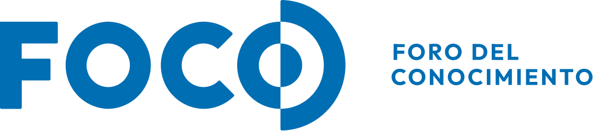
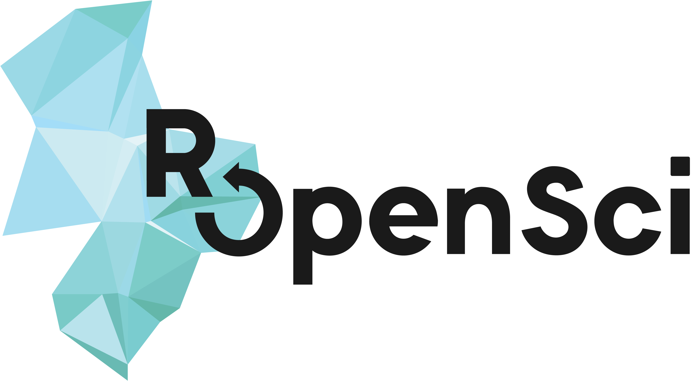
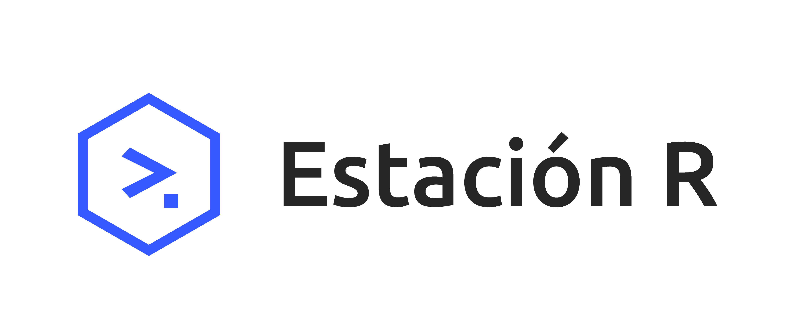
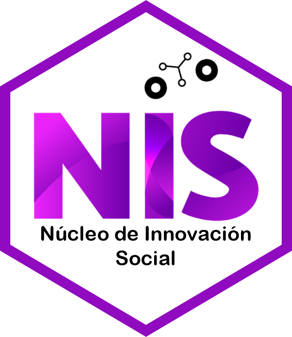
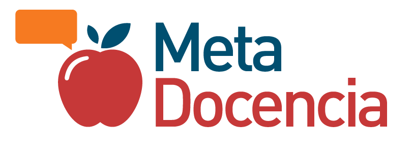
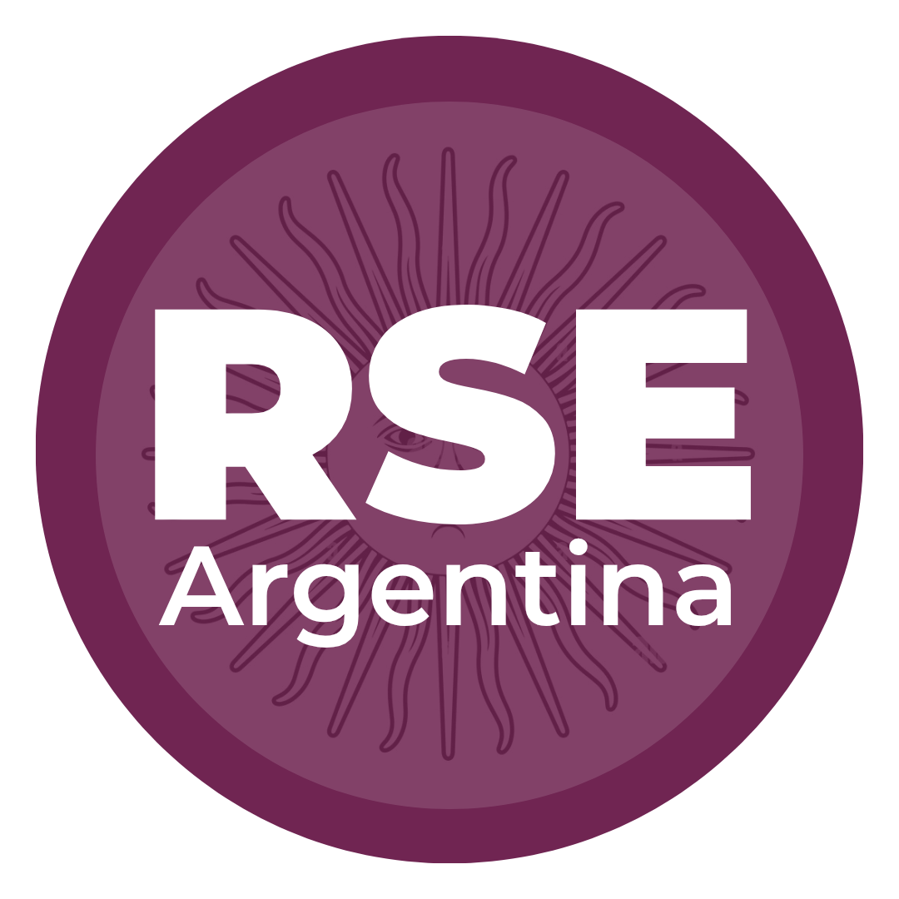
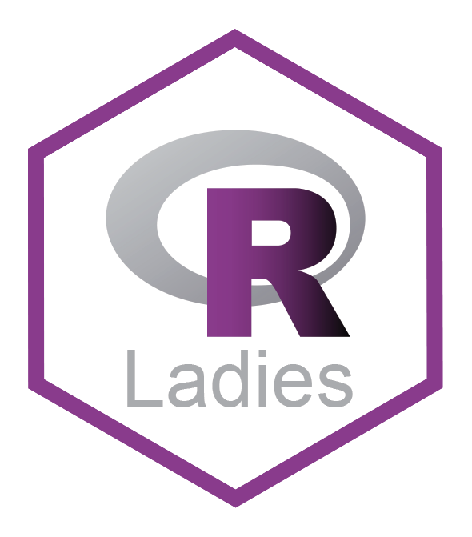
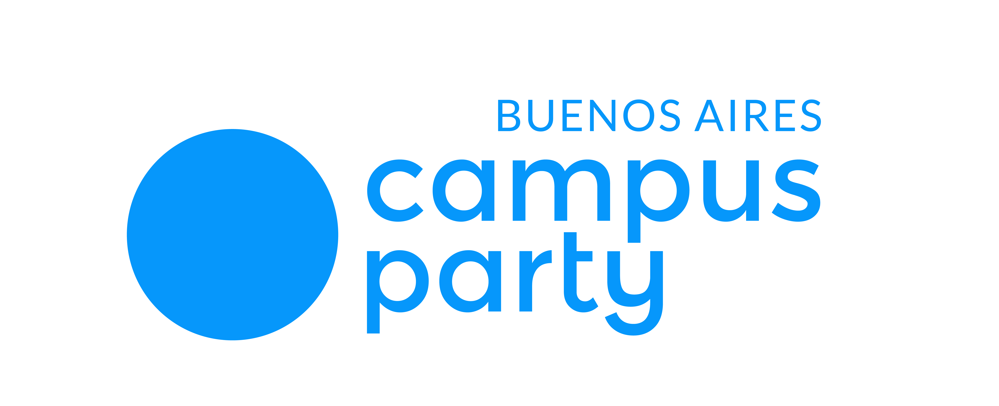
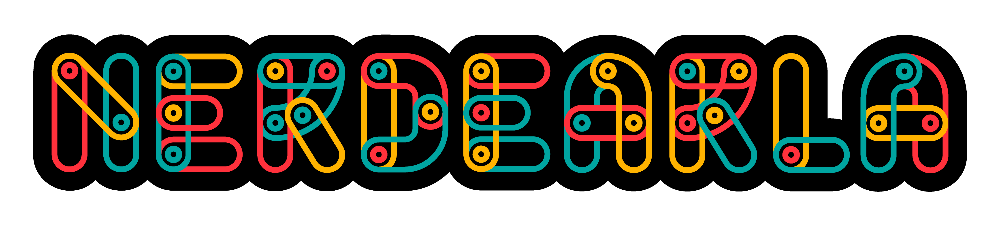
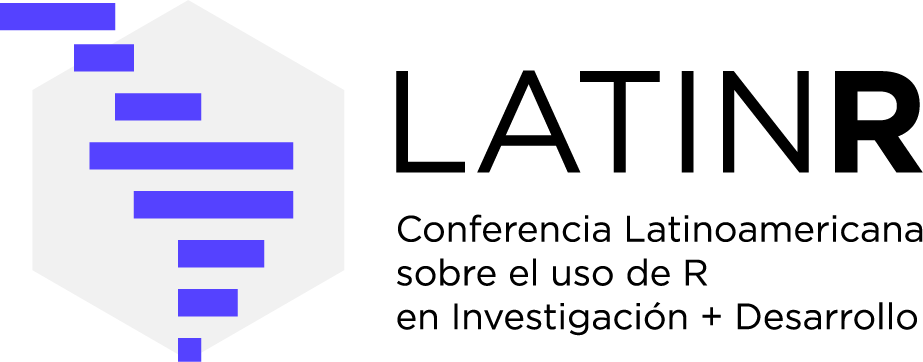

La red de R en Buenos Aires se sostiene gracias al apoyo de comunidades amigas, organizaciones e instituciones que creen en el valor del trabajo colectivo. Juntes impulsamos actividades, generamos espacios de encuentro y promovemos el uso de software libre como una forma de abrir oportunidades y acercar el conocimiento a más personas.

Muchas universidades y organizaciones nos prestan aulas y espacios para realizar talleres y encuentros sin costo, algo fundamental porque **el trabajo en esta comunidad es 100% voluntario.** Ese acompañamiento permite que más personas puedan participar, aprender y ser parte, sin barreras.

Así seguimos construyendo una comunidad activa, abierta y con ganas de seguir creciendo compartiendo lo que sabemos.

## Organizaciones aliadas

Proyectos, colectivos y grupos que colaboran con iniciativas concretas, difusión, recursos técnicos o actividades conjuntas. Su participación potencia el crecimiento de la comunidad y amplifica nuestro alcance.

::::: columns
::: {.column width="100%"}
[🔗 Comunidades Informáticas de Argentina - Foro del Conocimiento (FoCo)](https://informaticos.ar/encuentro-de-comunidades-informaticas/)

{width="80%"}
:::

:::::

::::: columns
::: {.column width="50%"}
[🔗 rOpenSci](https://ropensci.org/)

{width="80%"}
:::

::: {.column width="50%"}
[🔗 Estación R](https://estacion-r.com/)

{width="100%"}

:::
:::::

::::: columns
::: {.column width="50%"}
[🔗 Nucleo de Innovación Social - NIS](https://nucleodeinnovacionsocial.com.ar/)

{width="40%"}
:::

::: {.column width="50%"}
[🔗 MetaDocencia](https://metadocencia.org/)

 

{width="80%"}
:::
:::::

## Comunidades amigas

Espacios con los que compartimos afinidad, intereses y actividades. Nos apoyamos mutuamente, coorganizamos eventos y aprendemos colectivavmente.

::::: columns
::: {.column width="50%"}
[🔗 RSE Argentina](https://rse-argentina.github.io/)

{width="60%"}
:::

::: {.column width="50%"}

:::
:::::

::::: columns
::: {.column width="50%"}
[🔗 R-Ladies Buenos Aires](https://github.com/RLadies-BA)

{width="60%"}
:::

::: {.column width="50%"}
[🔗 R-Ladies Santa Rosa](https://www.meetup.com/rladies-santa-rosa/A)

{width="50%"}
:::
:::::

 

## Conferencias Aliadas

Conferencias con las que colaboramos a través de charlas cortas, talleres o como community partners para difundir sus actividades. Estos vínculos fortalecen el intercambio y el trabajo conjunto entre comunidades.

::::: columns
::: {.column width="50%"}
[🔗 Campus party Buenos Aires](https://argentina.campus-party.org/)

{width="100%"}
:::

::: {.column width="50%"}
[🔗 nerdear.la](https://nerdear.la/)

 

{width="100%"}
:::
:::::

::::: columns
::: {.column width="50%"}
[🔗 LatinR](https://github.com/LatinR)

{width="80%"}
:::

::: {.column width="50%"}
:::
:::::

 

## Instituciones que nos acompañan

Universidades, centros de estudio u organismos que nos brindan espacios físicos, aulas o apoyo institucional para llevar adelante nuestras actividades. Su apoyo es clave para sostener una comunidad abierta, gratuita y colaborativa.

::::: columns
::: {.column width="50%"}
[🔗 Universidad de Flores](https://www.uflouniversidad.edu.ar/)

 

{width="50%"}
:::

::: {.column width="50%"}
:::
:::::

:::: columns
::: {.column width="100%"}
[🔗 Universidad Nacional de la Matanza - Biblioteca Leopoldo Marechal - UNLAM](https://www.unlam.edu.ar/)

 

{width="30%"} 
:::
::::
