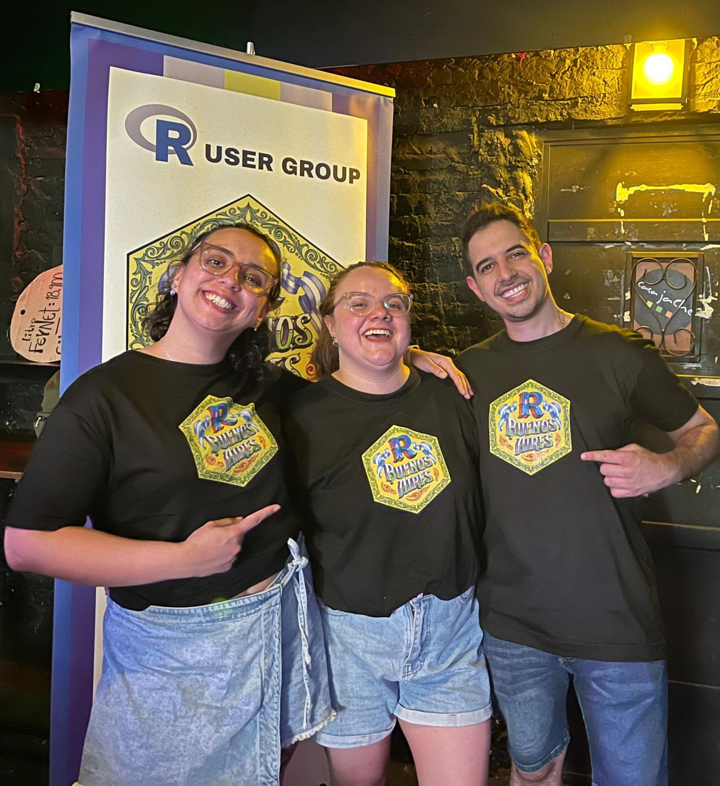
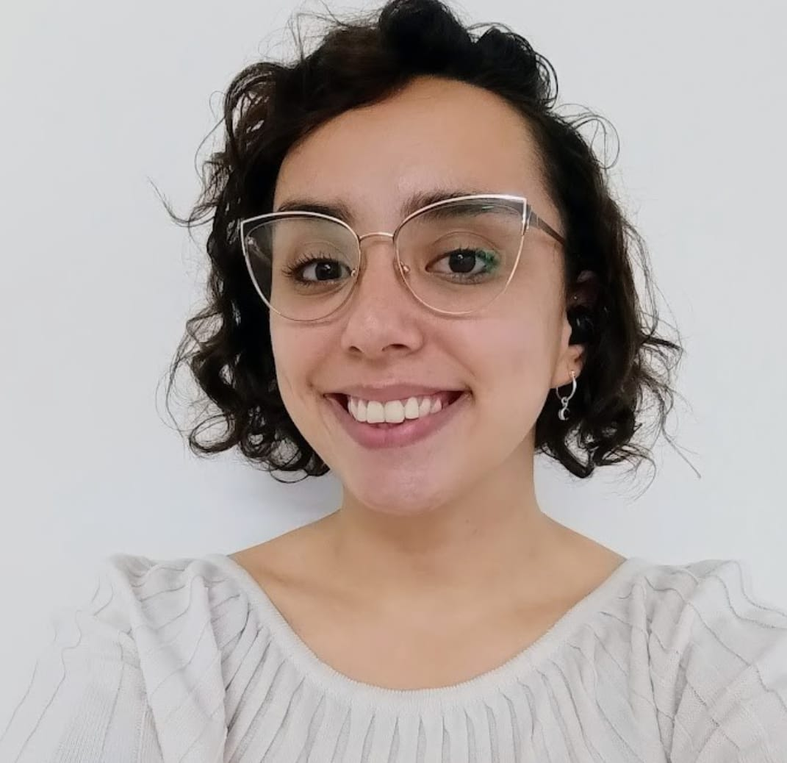

::::: columns
::: {.column width="60%" style="font-size: 24px; align-self: center;"}

 

El corazón de R en Buenos Aires está en su comunidad, pero nada sería posible sin el esfuerzo y compromiso de quienes organizan y colaboran activamente para que cada evento y proyecto cobre vida.

:::

::: {.column width="40%"}

{width="80%" style="border-radius: 80%;" fig-align="right"}

:::
:::::

:::::: grid
::: {#andrea .g-col-12 .g-col-md-4 .hex-equipo}
{width="50%" style="border-radius: 80%;"}

**Andrea Gomez Vargas**

 

[[]{.bi .bi-github}**GitHub**](https://github.com/SoyAndrea)

[[]{.bi .bi-linkedin} **LinkedIn**](https://www.linkedin.com/in/andreasociologa/)
:::

::: {#ariana .g-col-12 .g-col-md-4 .hex-equipo}
{width="50%" style="border-radius: 80%;"}

**Ariana Bardauil**

 

[[]{.bi .bi-github} **GitHub**](https://github.com/ariibard)

[[]{.bi .bi-linkedin} **LinkedIn**](https://www.linkedin.com/in/ariana-bardauil/)
:::

::: {#emanuel .g-col-12 .g-col-md-4 .hex-equipo}
{width="50%" style="border-radius: 80%;"}

**Emanuel Ciardullo**

 

[[]{.bi .bi-github}**GitHub**](https://github.com/ECiardullo)

[[]{.bi .bi-linkedin} **LinkedIn**](https://www.linkedin.com/in/eciardullo/)
:::
::::::
