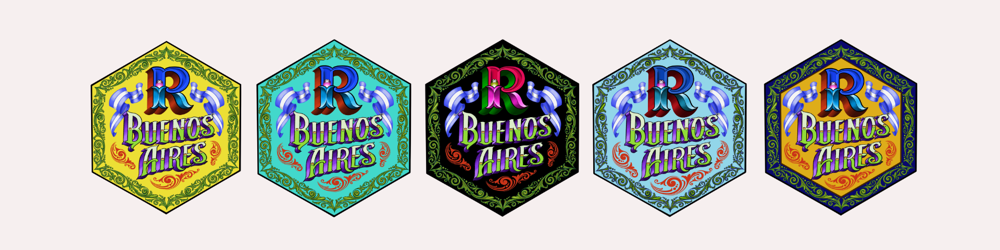

Inspirades en la esencia de Buenos Aires y en su capacidad de renovarse, incorporamos el fileteado a nuestro hex como un símbolo colorido de identidad, comunidad y conexión... y por qué no, también de nuestra comunidad dentro del grupo de usuarios de R.

::: hex-card
Elaborado por **Norberto Cáseres**\
[ \@estudiodefileteado](https://www.instagram.com/estudiodefileteado)

{width="800px"}
:::
