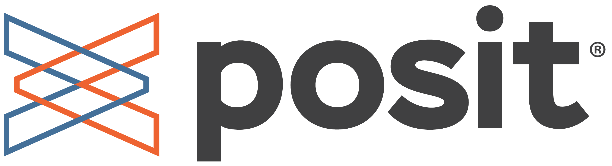

R en Buenos Aires cuenta con el apoyo de Posit PBC a través de su [Community Support Program](https://opensource.posit.co/about/community-support/), una iniciativa que acompaña a comunidades que promueven el aprendizaje, el intercambio y el uso de herramientas abiertas para trabajar con datos.

Durante el período 2026–2027, Posit brinda apoyo económico a R en Buenos Aires para contribuir al desarrollo de sus actividades y al fortalecimiento de la comunidad local de personas usuarias de R.

